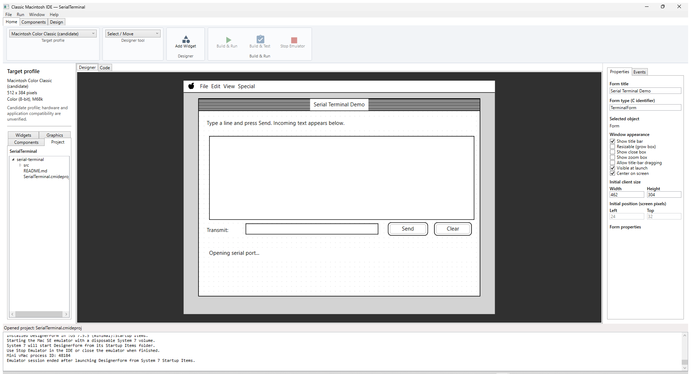
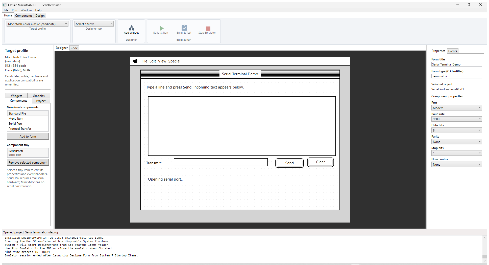

# Classic Mac for Dummies 4: Build RetroTerm from Scratch

This guide starts with a new ClassicMacStudio project, builds RetroTerm's
one-bit Macintosh interface, explains how its native C code works, and shows
how to put the finished application on a BlueSCSI-compatible hard-disk image.
It assumes Windows, the repository checkout, and the prerequisites in the
[ClassicMacStudio setup guide](../../README.md).

Keep the Windows IDE at **1920 × 1080** while following this guide. That is
the host display resolution; the application form itself is designed for the
Macintosh SE's 512 × 342 one-bit screen.

> **About the screenshots:** the screenshots below are retained IDE
> orientation references from the older Serial Terminal walkthrough. They
> are not screenshots of RetroTerm. Use the exact control table and values
> below to create RetroTerm's form.

## 1. Create a new Macintosh SE project

1. Start ClassicMacStudio and choose **File → New Project...**.
2. Save the project in a new working folder as `RetroTerm.cmideproj`. Do not
   edit the checked-in sample in place.
3. In **Target profile**, choose **Macintosh SE** (`mac-se-68k`). Confirm the
   profile shows a 512 × 342 monochrome display.
4. Select the form, then set its properties:

   | Property | Value |
   | --- | --- |
   | Name / form type | `RetroTermForm` |
   | Title | `RetroTerm 0.2` |
   | Width, height | `462`, `262` |
   | Show title bar | Yes |
   | Close box | Yes |
   | Resizable, zoom box | No |
   | Visible, movable | Yes |
   | Center on screen | Yes |

5. Save with **File → Save Project**.

The positions in this guide are target pixels relative to the form's content
area, not Windows screen coordinates. The native window has a close box and
RetroTerm also has an in-window **Quit** button.



*This image is an IDE navigation reference only; it does not show the
RetroTerm form.*

## 2. Draw and configure the form

Choose **Widgets** in the left Toolbox / Project Explorer pane. For each row,
select the listed widget, click **Place on form**, and then select the new
control to edit its stable ID, caption, and bounds in the right
**Properties / Events** inspector. Keep the listed order: RetroTerm's native C
code uses the generated dialog item numbers.

| # | Widget | Stable ID | Text / caption | Position `(x, y, w, h)` |
|---:|---|---|---|---|
| 1 | Static Text | `ConnectionStatus` | `Port closed. Select settings, then click Open.` | `12, 8, 438, 18` |
| 2 | Static Text | `PortLabel` | `Port` | `12, 38, 34, 18` |
| 3 | Popup Menu | `PortSelector` | `MODEM` | `50, 36, 92, 22` |
| 4 | Static Text | `BaudLabel` | `Baud` | `158, 38, 38, 18` |
| 5 | Popup Menu | `BaudSelector` | `9600` | `202, 36, 76, 22` |
| 6 | Push Button | `OpenCloseButton` | `Open` | `286, 35, 64, 24` |
| 7 | Check Box | `LocalEcho` | `Local Echo` | `360, 38, 100, 18` |
| 8 | Static Text | `TerminalText` | *(empty)* | `12, 68, 438, 164` |
| 9 | Static Text | `Instructions` | `Click the terminal area to type. Echo shows sent characters.` | `12, 240, 366, 18` |
| 10 | Push Button | `QuitButton` | `Quit` | `390, 238, 60, 20` |

Set the popup properties and initial checkbox state:

| Control | Property | Value |
| --- | --- | --- |
| `PortSelector` | Items | `MODEM` then `PRINTER`, one item per line |
| `PortSelector` | Selected index | `0` |
| `BaudSelector` | Items | `300`, `600`, `1200`, `1800`, `2400`, `3600`, `4800`, `7200`, `9600`, `14400`, `19200`, `28800`, `38400`, `57600`, one per line |
| `BaudSelector` | Selected index | `8` |
| `LocalEcho` | Checked | Yes |

The menu's selected index is zero-based in the Designer. The native Macintosh
Menu Manager numbers menu choices starting at one. Thus index `8` selects
9600 from the 14-item baud list.

## 3. Add the serial-port component

Serial I/O is nonvisual, so add it to the component tray rather than the form:

1. Select **Components** in the left palette.
2. Select **Serial Port**, then choose **Add to form**.
3. Set the component ID to `SerialPort1` and configure:

   | Property | Value |
   | --- | --- |
   | Port | Modem |
   | Baud | 9600 |
   | Data bits | 8 |
   | Parity | None |
   | Stop bits | 1 |
   | Flow control | None |

4. Leave the component event bindings empty, then save the project.

This distinction matters: the form records the serial settings, but
RetroTerm's native `main.c` opens `.AIn`/`.AOut` or `.BIn`/`.BOut` directly
through the Macintosh Serial Manager. Its own event loop handles serial input;
it does not call the generated form runtime or component event handlers.
Do not add a second serial-open path.



*This screenshot illustrates the component inspector, not the current
RetroTerm project's exact form.*

## 4. Add the native C application

ClassicMacStudio creates a `src` folder for the project. Open `src/main.c` in
the IDE's code editor and replace its starter code with the documented
[RetroTerm `main.c`](../../feasibility/samples/retroterm/src/main.c). The
complete application includes startup diagnostics, serial-driver cleanup,
keyboard handling, local echo, a bounded terminal buffer, and monochrome
QuickDraw drawing. It is intentionally longer than a beginner tutorial can
print in full; the snippets below explain its main parts.

The source starts with a Doxygen file comment and documents its functions with
`@brief`, `@param`, `@return`, and `@note`. For example:

```c
/**
 * @brief Open the selected input/output drivers and configure serial framing.
 * @return The Serial Manager result code; noErr indicates the port is open.
 */
static OSErr TerminalOpenPort(void);
```

In the function navigator, read and build the implementation in this order:

1. **Constants and state.** Dialog item IDs must match the order in the
   control table: status is item 1, the port popup item 3, baud popup item 5,
   Open item 6, Local Echo item 7, terminal pane item 8, and Quit item 10.
2. **Serial setup and cleanup.** `TerminalOpenPort` chooses the driver pair,
   opens it, sets the baud and 8-N-1 format, and reports errors.
   `TerminalCloseDrivers` attempts to close both driver references, even if
   closing one fails.
3. **Receive and display.** `TerminalPollSerial` reads available bytes.
   `TerminalAppendByte` accepts printable 7-bit ASCII plus CR/LF, tab, and
   backspace; it ignores other controls and high-bit bytes.
4. **Transmit and echo.** Clicking the terminal area gives it keyboard focus.
   Supported characters are sent immediately; when Local Echo is checked,
   RetroTerm also adds the successfully sent characters to its local display.
5. **Drawing and events.** `TerminalDrawTextView` uses QuickDraw text-width
   measurements to wrap long lines. The event loop handles menu selection,
   serial polling, close-box clicks, and the Quit button.

The display buffer is deliberately limited to 255 bytes. When full, it drops
the oldest text so the application cannot consume unbounded memory. CR/LF
create line breaks, and long lines also wrap at the pane edge.

The generated project source also references
`MacStudioUserControlClicked`. Keep `src/user_events.c` with this no-op
callback; RetroTerm handles its controls in its own event loop:

```c
#include <Dialogs.h>

void MacStudioUserControlClicked(
    DialogPtr form,
    const char *controlId,
    short item)
{
    (void)form;
    (void)controlId;
    (void)item;
}
```

`main.c` defines `MacStudioFormDidLoad` to satisfy the generated source as
well. It is not the application entry point in this project: the custom
`main` function loads and runs the native dialog itself.

## 5. Understand the generated Macintosh resources

When you build an IDE project, ClassicMacStudio generates
`src/designer_form.c`, `src/designer_form.h`, `src/designer_form.r`, and a
`src/CMakeLists.txt` from the form. It preserves your editable `main.c` and
`user_events.c`. The generated Rez file creates the DLOG/DITL dialog, controls,
and popup menus; you do not need to type Rez resources for an IDE build.

RetroTerm loads dialog resource 128. The two popup-menu resources are based on
their DITL item numbers: port menu item 3 uses menu resource 259, and baud
menu item 5 uses resource 261. Keep the form's control order unchanged unless
you update the matching constants in `main.c`.

The checked-in standalone sample also has
[retroterm.r](../../feasibility/samples/retroterm/retroterm.r), which contains
the equivalent native dialog resources for its standalone Retro68 CMake
build. When maintaining both paths, keep the control order, text, bounds, and
menu contents in that file and the IDE project consistent.

## 6. Build and run from ClassicMacStudio

1. Save the project and both C files.
2. Select **Run → Mini vMac (Mac SE)**.
3. Choose **Build & Run**.
4. Let the IDE generate the resources, compile with Retro68, and launch the
   result in Mini vMac.

The IDE build normally creates
`<project-folder>\.build\DesignerForm.dsk`, an HFS volume containing the
application built from your new project. In the emulator, check that the
window opens, the port and baud menus display their defaults, and the Quit
button and native close box exit cleanly. The serial hardware itself cannot
be exercised in Mini vMac.

The IDE-generated application is named `DesignerForm`. To build the
checked-in implementation under the application name `RetroTerm`, use its
standalone Retro68 build from PowerShell at the repository root:

```powershell
wsl.exe -d Ubuntu -- bash <(sed 's/\r$//' /mnt/d/Repository/retro/ClassicMacStudio/scripts/wsl/build-hello-mac.sh) /mnt/d/Repository/retro/ClassicMacStudio/feasibility/samples/retroterm /mnt/d/Repository/retro/ClassicMacStudio/.local-tools/mac-image-build/retroterm RetroTerm
```

That command creates
`.local-tools/mac-image-build/retroterm/RetroTerm.dsk`. It builds the
checked-in C and Rez sources rather than regenerating the form. Use the IDE
build while iterating on a new form; use this standalone build when you want
the named RetroTerm application volume.

## 7. Create a BlueSCSI hard-disk image

The `.dsk` from either build is an HFS volume image. Disk Jockey Jr (`djjr`)
wraps that volume in a device image with an Apple partition map and Macintosh
SCSI driver.

From PowerShell at the repository root, convert the standalone RetroTerm
volume to a new SCSI ID 6 image and inspect it:

```powershell
$djjr = '/mnt/d/Repository/retro/ClassicMacStudio/.local-tools/diskjockey/djjr'
$volume = '/mnt/d/Repository/retro/ClassicMacStudio/.local-tools/mac-image-build/retroterm/RetroTerm.dsk'
$hda = '/mnt/d/Repository/retro/ClassicMacStudio/.local-tools/mac-image-build/retroterm/HD6_RetroTerm.hda'

wsl.exe -d Ubuntu -- $djjr convert to-device $volume $hda
wsl.exe -d Ubuntu -- $djjr analyze $hda
```

Confirm the analysis reports an Apple partition map, Macintosh SCSI driver,
HFS volume, and the RetroTerm application. The `HD6_` filename prefix selects
BlueSCSI SCSI ID 6; use the ID you have configured. `to-device` creates a
standalone device image from the HFS volume. This image contains RetroTerm but
is **not bootable** unless you also install a compatible Macintosh System
Folder; normally boot the Mac from its system disk and attach this image as a
second disk.

To add RetroTerm to a system HDA instead of creating a separate app disk:

1. Make a backup copy of the original HDA.
2. Use `djjr convert to-volume` to extract its HFS volume to a working file.
3. Export the app from `RetroTerm.dsk` as MacBinary II, then import that
   MacBinary file into the extracted system volume with Retro68's `hcopy -m`.
   Mount each HFS image with `hmount` and finish each mount with `humount`.
   MacBinary preserves both the application's data and resource forks.
4. Convert the updated HFS volume to a new device image with `djjr convert
   to-device`; do not overwrite the backup.
5. Run `djjr analyze` on the new image and verify the system files and
   RetroTerm are present before using it.

Use the Retro68 HFS utilities from the configured WSL toolchain. Do not copy
only the application's data fork: classic Macintosh applications also need
their resource fork.

## 8. Test the Macintosh application

On the Mac, boot from a system disk and attach the RetroTerm HDA. Confirm the
application opens, the close box and Quit button terminate it, and its serial
driver is released on exit. Send a printable string longer than the visible
line to verify wrapping. Test the physical MODEM or PRINTER port with a
matching 9600 8-N-1 connection.

The emulator verifies the interface and launch path. Only a real Macintosh,
serial cable, and correctly configured peer can verify physical serial
behavior.

## Source files

- [RetroTerm project layout](../../feasibility/samples/retroterm/RetroTerm.cmideproj)
- [Doxygen-documented 68k application](../../feasibility/samples/retroterm/src/main.c)
- [Application event callback](../../feasibility/samples/retroterm/src/user_events.c)
- [Standalone Macintosh dialog resources](../../feasibility/samples/retroterm/retroterm.r)
- [RetroTerm behavior specification](../../docs/retroterm-specification.md)
